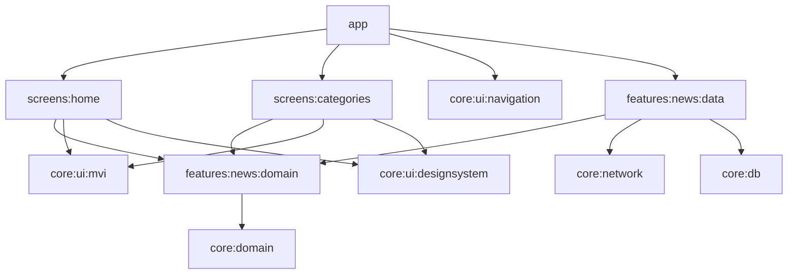

# News

News is a modular Android application for browsing the latest articles from
[NewsAPI](https://newsapi.org/). It provides a searchable news feed, category
filtering, pagination, local Room caching, and resilient loading and error
states.

## Features

- Latest US headlines
- Debounced article search
- Filtering by NewsAPI categories
- Infinite-scroll pagination with retry support
- Local cache separated by feed, search query, and category
- Cached content displayed before a network refresh
- Skeleton, empty, offline, initial-error, and inline-error states
- Bottom navigation with independent Home, Categories, and Settings back stacks
- Persistent dark-theme and haptic-feedback preferences with an interactive pull-cord lamp
- Two-step demo sign-in, persisted user sessions, and logout that clears preferences and cached articles
- Support for `/v2/top-headlines`, `/v2/everything`, and
  `/v2/top-headlines/sources`

## Architecture

The project uses a modular, layered architecture. Presentation modules depend
on feature-domain contracts, while concrete network and database-backed
implementations live in the feature data module and are connected through
Hilt.



### MVI

Every screen follows the same unidirectional state flow:

```text
UI intent -> MviViewModel -> partial state -> reducer -> StateFlow -> UI
                                |
                                +-> SharedFlow effect
```

- `Intent` represents a user or lifecycle action.
- `ViewModel` performs asynchronous work and emits a `Partial` result.
- `Reducer` is the single place where a `Partial` transforms immutable UI
  state.
- `StateFlow` exposes the current state to Compose.
- `Effect` is available for one-time events.
- `BaseScreen` provides shared loading, content, offline, and error-state
  handling.

### Data flow

For the initial page, a screen first requests articles stored for the current
`NewsRequest`. Cached content is rendered immediately when available, after
which the repository refreshes it from NewsAPI. Successful remote pages are
written to Room in a transaction.

The cache uses an independent context key for:

- the main feed;
- each normalized search query;
- each selected category.

Subsequent pages are requested as the list approaches its end and appended to
the current context. Network failures do not remove previously cached content.

### Navigation

`MainContainer` selects between `authFlow` and `regularFlow` from the persisted
user session. Only `regularFlow` contains the Home, Categories, and Settings
bottom-navigation destinations. Navigation is implemented with Navigation 3.
Each destination owns a separate `NavBackStack`, `ViewModelStore`, and saved
state, so switching tabs preserves its navigation and UI state. Leaving a flow
removes its entries and screen ViewModels; logout also resets all tab stacks.

### Demo authentication

Enter any nonblank username of up to 32 Unicode characters, the password
`news`, and then the four-digit code `1111`. This is a local mock: no email is
sent. The app stores only the verified user's name in DataStore after the code
succeeds; passwords and codes stay in memory and are redacted from MVI logs.
Subsequent launches restore the user and enter the regular flow directly.

Settings displays the user's name and uppercase initial. Logout clears the
entire DataStore and every Room table, restores default preferences, and returns
to sign-in. A cache generation guard prevents pending news requests from
writing data from the previous session after cleanup.

## Module structure

```text
app
├── Application, Hilt composition root, and AppLogger binding
├── MainActivity / MainContainer / MainViewModel
└── application configuration

core
├── domain
│   ├── shared models and DataResult/NetworkError
│   └── application-level abstractions
├── db
│   ├── Room database, DAO, entity, and database mapper
│   └── database Hilt module
├── logging
│   └── Timber initialization
├── network
│   ├── domain — API contract
│   └── data — Ktor client, logging, and network error mapping
├── storage
│   ├── domain — generic Storage contract and serializer extensions
│   └── data — DataStore, settings adapter, and Hilt bindings
└── ui
    ├── designsystem — shared light/dark theme, colors, typography, shapes, and components
    ├── mvi — MVI contracts, MviViewModel, and BaseScreen
    ├── interactions — haptic effects contract, shared manager, and lifecycle-aware Compose handler
    └── navigation — destinations, manager, and Navigation 3 host

features
├── auth
│   ├── domain — user, challenge, authentication and session contracts
│   └── data — mock authentication, DataStore session, and logout cleanup
└── news
    ├── domain
    │   ├── NewsRepository
    │   └── local and remote data-source contracts
    └── data
        ├── NewsRepositoryImpl
        ├── NewsRemoteDataSourseImpl
        ├── NewsLocalDataSourseImpl
        ├── API DTOs and mappers
        └── Hilt bindings

screens
├── auth — sign-in and verification, following BaseScreen / MVI conventions
├── home — latest headlines, search, and pagination
├── categories — category selection and paginated articles
└── settings — user identity, logout, dark theme, haptic feedback, and animated pull-cord lamp
```

All three tabs use the same `NewsTheme` in `core:ui:designsystem`. Its light
ivory/green and dark navy/gold palettes also define lamp materials and lighting;
screens do not define their own colors. Settings follows the same `BaseScreen`,
`MviViewModel`, `model`, and `reducer` structure as Home and Categories.
`SettingsViewModel` writes preferences through the shared `AppSettingsStore`
domain contract. Its observable state keeps the app theme synchronized and is
persisted by `core:storage:data`. Storage supports JSON-serialized values with
blocking and suspend access. Serialization lets the generic API store primitive
values, collections, and custom objects. Existing SharedPreferences settings
migrate to DataStore on first use.

The launcher icon and native Android splash screen use the shared forest,
ivory, and gold palette. The splash fades into the app as soon as its first
frame is ready. The editable icon is `design/news-app-icon.svg`; regenerate
all legacy density variants on macOS with `swift design/export-launcher-icons.swift`.

## Main technology stack

| Area | Technology |
| --- | --- |
| Language | Kotlin 2.4.20 |
| UI | Jetpack Compose, Material 3 |
| Architecture | MVI, repository pattern, modular layered architecture |
| Async/state | Kotlin Coroutines, Flow, StateFlow, SharedFlow |
| Navigation | AndroidX Navigation 3 |
| Dependency injection | Hilt with KSP |
| Networking | Ktor Client with OkHttp engine |
| Serialization | Kotlinx Serialization |
| Persistence | Room |
| Image loading | Coil 3 |
| Logging | Timber |
| Testing | JUnit 4, kotlinx-coroutines-test |

The application targets Android API 37, supports API 29 and newer, and uses
Java 11 bytecode compatibility.

## Configuration

1. Create an API key at [newsapi.org](https://newsapi.org/).
2. Set the local value in `gradle/libs.versions.toml`:

   ```toml
   [versions]
   baseUrl = "https://newsapi.org/v2"
   apiKey = "YOUR_NEWS_API_KEY"
   ```

The values are exposed to the app through generated `BuildConfig` fields. Do
not commit a production API key to a public repository.

## Build and verification

Open the project in Android Studio and use a JDK compatible with the configured
Android Gradle Plugin. The main Gradle commands are:

```bash
# Build the debug APK
./gradlew :app:assembleDebug

# Run all debug unit tests
./gradlew testDebugUnitTest

# Run Android lint
./gradlew lintDebug

# Run the complete local verification used by the project
./gradlew testDebugUnitTest lintDebug :app:assembleDebug
```

The generated debug APK is available at:

```text
app/build/outputs/apk/debug/app-debug.apk
```

## Testing

The current unit-test suite covers:

- MVI reducers and ViewModel state transitions;
- pagination and retry scenarios;
- navigation-manager behavior;
- repository cache and remote-source coordination;
- Room entity mapping;
- API/domain mapping and network error classification.
